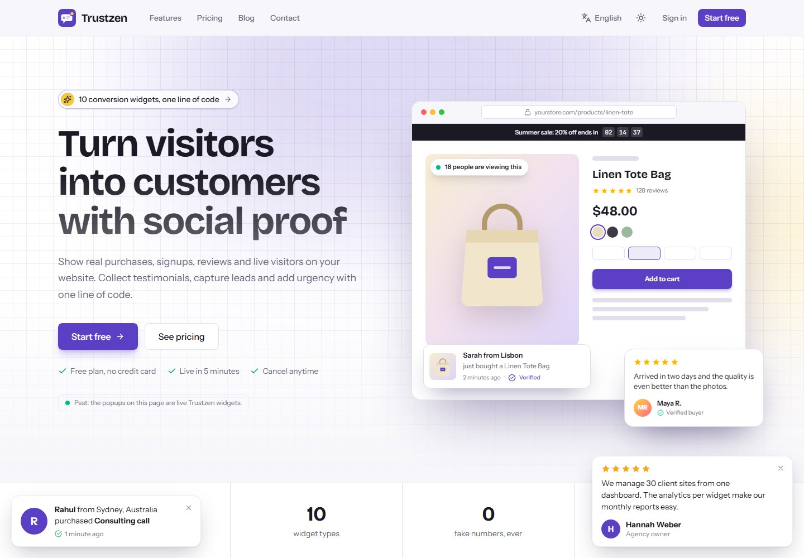
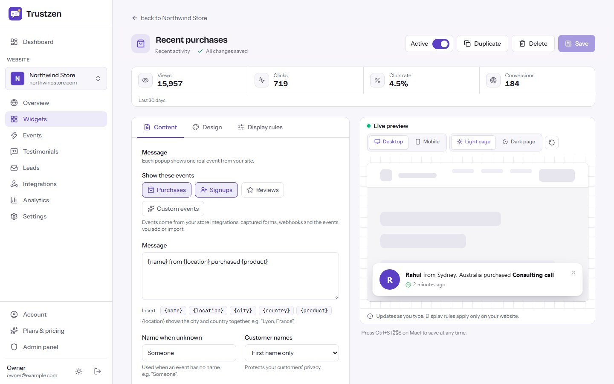
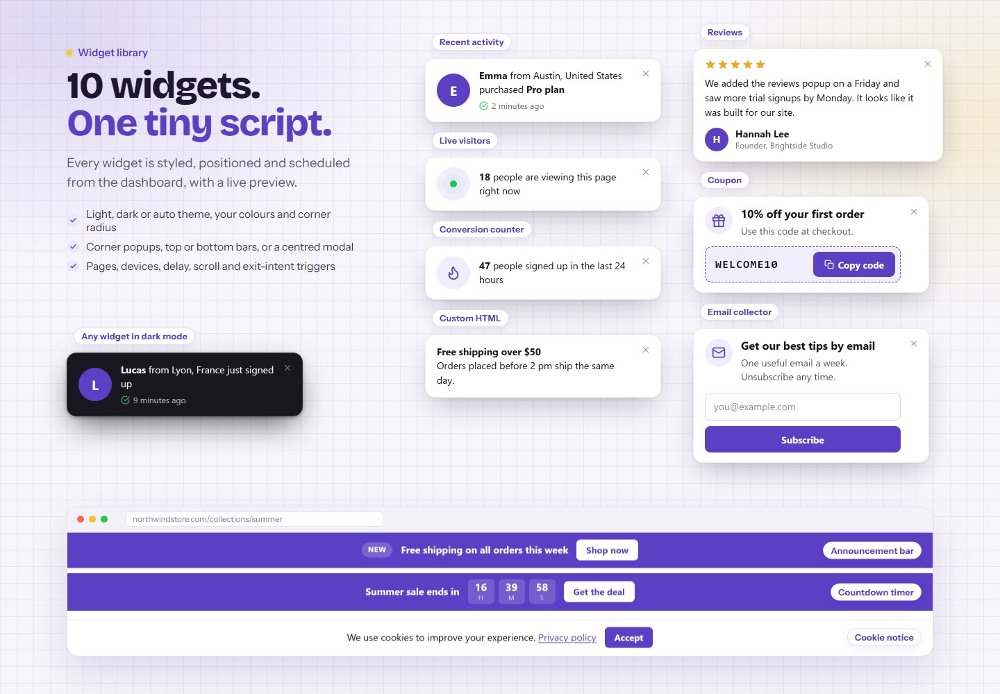
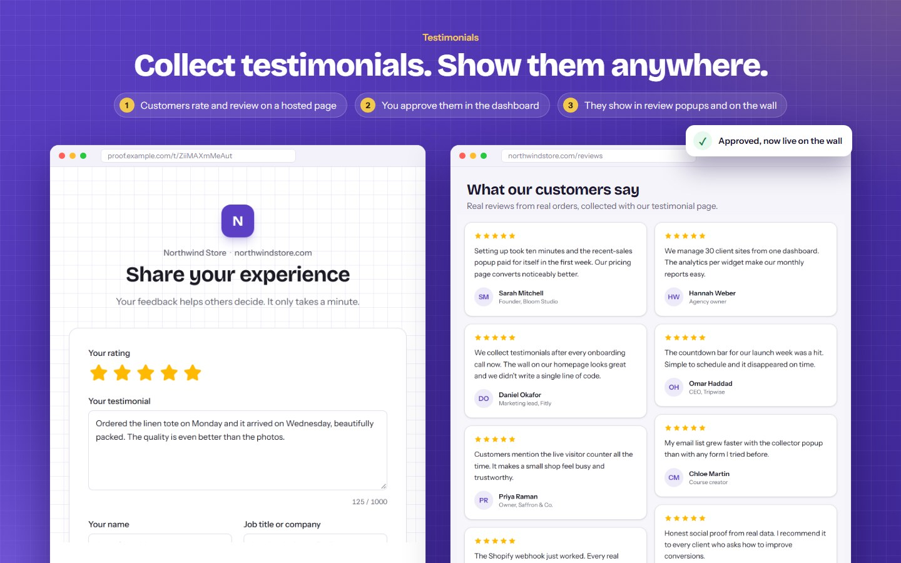
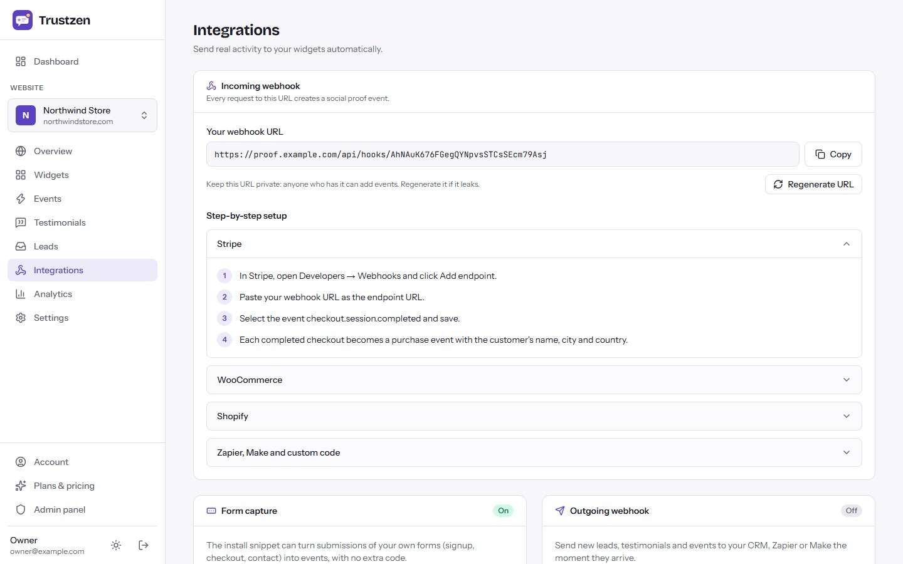
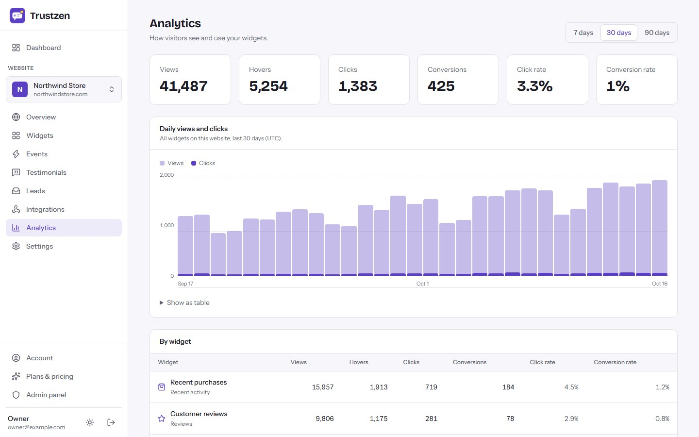
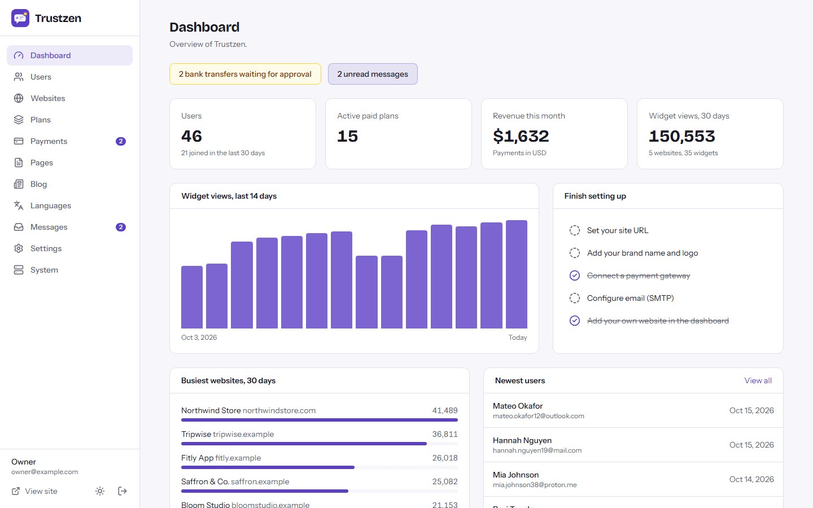

# Trustzen

**Open-source social proof, testimonial and conversion widgets — as a self-hosted SaaS.** Built
with Next.js 16, React 19 and Tailwind CSS 4. Runs on a VPS, Docker, cPanel (Node.js) or Vercel,
with MySQL/MariaDB or a zero-setup SQLite database.

**Live demo:** https://trustzen-eight.vercel.app — log in with `demo@trustzen.app` / `demo12345`
(read-only demo).



## Features

- **10 widget types:** recent activity (purchases and signups), live visitors, conversion counter,
  reviews, announcement bar, coupon, countdown, email collector, cookie notice and custom HTML.
- **Visual widget editor** with a live light/dark, desktop/mobile preview, design options and
  display rules (pages with wildcards, devices, load/delay/scroll/exit-intent triggers, rotation,
  frequency, start and end dates).
- **Real data:** form capture, incoming webhooks (Stripe, WooCommerce, Shopify and generic JSON for
  Zapier or Make), CSV import and manual events.
- **Testimonials:** hosted collection page with star rating and photo, moderation queue,
  auto-approve and an embeddable testimonial wall.
- **Leads, analytics and outgoing webhooks:** email leads with CSV export, views / hovers / clicks /
  conversions per widget and day, and signed (HMAC-SHA256) JSON webhooks to any CRM.
- **Lightweight embed:** one script tag, about 14 KB gzipped, no dependencies, rendered in a Shadow
  DOM, domain-locked public API, no cookies set by widgets and no visitor IP addresses stored.
- **SaaS ready:** customer accounts, plans with website / widget / monthly view limits and branding
  removal, Stripe / PayPal / Razorpay / bank transfer payments, a blog and a full admin panel.
- **Multi-language** with right-to-left support (Arabic and Hindi packs included).
- **Web installer** — no command line needed on shared hosting.

| Widget editor | Widget library | Testimonials |
| --- | --- | --- |
|  |  |  |
| **Integrations & webhooks** | **Analytics** | **Admin panel** |
|  |  |  |

More screenshots are in [`marketing/final/screenshots`](marketing/final/screenshots).

## Hosted version & paid installation

Need Trustzen hosted for you, installed on your own server, or customised? Contact
**[EpiFive](https://www.epifive.com/services)**.

More open-source projects: https://www.epifive.com/open-source

## Quick start

```bash
git clone https://github.com/epifive/trustzen.git
cd trustzen/app
npm install
npm run dev
```

Open http://localhost:3000 — you are redirected to the web installer at `/install`. Choose
**SQLite** for a zero-setup local database, or **MySQL/MariaDB** for production. `npm run dev` also
builds the embed script `public/w.js`. To try widgets locally, add a website with the domain
`localhost` in the dashboard and paste its snippet into any page served from `http://localhost`.

Production, Docker, PM2, cPanel and Vercel setups and every setting are covered in
[`app/README.md`](app/README.md) and the full guide in
[`documentation/index.html`](documentation/index.html) (open it in a browser).

**Requirements:** Node.js 20.9+ (22.13+ for SQLite), MySQL 5.7+ / MariaDB 10.3+ or SQLite, and
HTTPS in production (customers embed `https://your-domain/w.js`).

## Repository layout

| Path | What |
| --- | --- |
| `app/` | The Next.js application (dashboard, widget editor, embed script, public API, admin, installer) |
| `documentation/` | Full user and admin guide (single HTML file) |
| `marketing/` | Screenshot and preview scripts and the final screenshots |

## Contributing

Bug reports and pull requests are welcome — please open an
[issue](https://github.com/epifive/trustzen/issues) first for larger changes. Run
`npm run lint`, `npm run typecheck` and `npm run build` in `app/` before sending a PR.

## License

[MIT](LICENSE) © 2026 EpiFive
